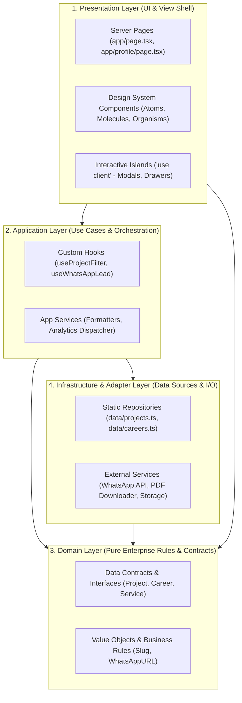

# ASRAKIT DESIGN SYSTEM & CLEAN FRONTEND ARCHITECTURE SPECIFICATION
**Version:** 1.0.0 (Engineering Ready)  
**Author:** Senior Software Engineer  
**Reference:** [docs/PRD.md](file:///Users/mac/Sites/asrakit/webprofile/docs/PRD.md)  
**Status:** Canonical Reference Architecture

---

## 1. Executive Architectural Overview

Dokumen ini mendefinisikan standar **Design System** dan **Software Architecture** untuk platform Asrakit Webprofile. Dokumen ini dirancang khusus untuk memenuhi 6 pilar utama:
1. **Clean Architecture:** Pemisahan *concern* yang tegas antara Domain, Application, Infrastructure, dan Presentation.
2. **SOLID Principles:** Penerapan prinsip desain berorientasi objek dan fungsional modern dalam ekosistem React/Next.js & TypeScript.
3. **Easy Maintenance:** *Single source of truth* untuk data & token desain, kode modular, dan minim ketergantungan (*low coupling, high cohesion*).
4. **Extensible (Mudah Dikembangkan):** Menambah proyek, layanan bisnis, atau komponen baru tanpa mengubah kode inti (*Open/Closed*).
5. **Human-Readable & Predictable:** Pola penamaan deklaratif, struktur folder seragam, dan *strict typing*.
6. **Ultra Performance & Zero Lag:** *Zero runtime styling overhead*, render server-first (RSC), 60 FPS GPU-accelerated micro-interactions, LCP < 1.2s, dan Cumulative Layout Shift (CLS) = 0.00.

---

## 2. Layered Clean Architecture Topology

Frontend modern sering kali terjebak dalam *component-spaghetti* di mana logika pemanggilan data, transformasi bisnis, dan render UI bercampur di satu file komponen. Di Asrakit Webprofile, kita menerapkan **Layered Clean Architecture** yang disesuaikan dengan paradigma **React Server Components (RSC)**:



### 2.1 Definisi Tanggung Jawab Tiap Layer

| Layer | Cakupan & Lokasi | Aturan Ketergantungan (*Dependency Rule*) |
| :--- | :--- | :--- |
| **Domain** | `src/domain/` atau `types/` | **Zero Dependencies**. Berisi model tipe data (`ProjectDetail`, `CareerItem`), konstanta domain, dan validasi murni. Tidak boleh mengimpor React, Next.js, atau pustaka eksternal. |
| **Application** | `src/application/` | Berisi logika aplikasi (*Use Cases*, *State Hooks*, *Event Handlers*). Tidak memanipulasi DOM secara langsung; hanya memproses data domain untuk disajikan ke UI. |
| **Infrastructure** | `src/infrastructure/` | Berisi *adapter* data konkret, implementasi *repository* (saat ini *static dataset*, dapat dialihkan ke Headless CMS/API tanpa mengubah domain), dan utilitas I/O pihak ketiga (WhatsApp link generator). |
| **Presentation** | `src/components/`, `src/app/` | Hanya bertanggung jawab merender antarmuka pengguna, menerapkan Design Tokens, menerima *props*, dan menangkap *user interactions*. |

---

## 3. SOLID Principles Implementation Blueprint

Berikut adalah implementasi nyata prinsip **SOLID** dalam arsitektur komponen React + TypeScript:

### 3.1 S — Single Responsibility Principle (SRP)
> *Satu komponen atau modul hanya boleh memiliki satu alasan untuk berubah.*

* **Pelanggaran (Anti-Pattern):** Komponen `ProjectCard.tsx` yang merender UI, membuat URL WhatsApp sendiri, menangani event analitik, dan memformat tanggal/durasi.
* **Standar Asrakit:**
  1. `ProjectCard.tsx` (Presentation) hanya bertugas merender UI dari *props*.
  2. `useWhatsAppLead.ts` (Application Hook) bertanggung jawab memformulasikan payload URL WhatsApp.
  3. `formatCurrency` / `formatDuration` (Domain Helper) berada di utilitas murni.

```typescript
// ✅ Presentation murni: Hanya peduli pada tampilan dan event callback
interface ProjectCardProps {
  readonly project: ProjectDetail;
  readonly onSelectDetail: (projectId: string) => void;
}

export function ProjectCard({ project, onSelectDetail }: ProjectCardProps) {
  return (
    <article className="group relative rounded-xl border border-white/10 bg-slate-900/60 p-6 backdrop-blur-md transition-all duration-200 hover:border-orange-500/40">
      <h3 className="text-xl font-semibold text-slate-100">{project.title}</h3>
      <p className="mt-2 text-sm text-slate-400 line-clamp-2">{project.subtitle}</p>
      <button 
        type="button"
        onClick={() => onSelectDetail(project.id)}
        className="mt-4 text-xs font-medium text-orange-400 hover:text-orange-300 focus-visible:outline-orange-400"
      >
        Detail Solusi & Arsitektur →
      </button>
    </article>
  );
}
```

### 3.2 O — Open/Closed Principle (OCP)
> *Komponen terbuka untuk ekstensi, namun tertutup untuk modifikasi langsung.*

Menggunakan pola **Variant Composition** (bertenaga `cva` - *Class Variance Authority*) dan komposisi slot (*polymorphic*):

```typescript
// src/components/ui/Badge.tsx
import { cva, type VariantProps } from 'class-variance-authority';
import type { ReactNode } from 'react';

const badgeVariants = cva(
  "inline-flex items-center gap-1.5 px-2.5 py-1 rounded-full text-xs font-medium transition-colors",
  {
    variants: {
      intent: {
        primary: "bg-orange-500/10 text-orange-400 border border-orange-500/20",
        neutral: "bg-slate-800 text-slate-300 border border-slate-700",
        success: "bg-emerald-500/10 text-emerald-400 border border-emerald-500/20",
      },
      size: {
        sm: "text-[11px] py-0.5 px-2",
        md: "text-xs py-1 px-2.5",
      }
    },
    defaultVariants: {
      intent: "primary",
      size: "md",
    }
  }
);

interface BadgeProps extends VariantProps<typeof badgeVariants> {
  children: ReactNode;
  className?: string;
}

export function Badge({ children, intent, size, className }: BadgeProps) {
  return (
    <span className={badgeVariants({ intent, size, className })}>
      {children}
    </span>
  );
}
// Ekstensi variant baru dilakukan lewat konfigurasi variants tanpa membongkar komponen
```

### 3.3 L — Liskov Substitution Principle (LSP)
> *Subtipe atau implementasi antarmuka harus dapat menggantikan tipe induknya tanpa merusak fungsionalitas sistem.*

Untuk sumber data proyek atau riwayat karir, kita mendefinisikan kontrak interface *Repository*:

```typescript
// src/domain/repositories/IProjectRepository.ts
export interface IProjectRepository {
  getAll(): Promise<ProjectDetail[]>;
  getById(id: string): Promise<ProjectDetail | null>;
  getByCategory(category: ProjectCategory): Promise<ProjectDetail[]>;
}

// src/infrastructure/repositories/StaticProjectRepository.ts
export class StaticProjectRepository implements IProjectRepository {
  async getAll(): Promise<ProjectDetail[]> {
    return PROJECTS_DATA;
  }
  async getById(id: string): Promise<ProjectDetail | null> {
    return PROJECTS_DATA.find(p => p.id === id) ?? null;
  }
  async getByCategory(cat: ProjectCategory): Promise<ProjectDetail[]> {
    return PROJECTS_DATA.filter(p => p.category === cat);
  }
}

// Nantinya, jika beralih ke Remote API / Headless CMS:
// export class ApiProjectRepository implements IProjectRepository { ... }
// Seluruh halaman Server Component dapat bertukar implementasi tanpa refactor satu pun baris JSX.
```

### 3.4 I — Interface Segregation Principle (ISP)
> *Klien tidak boleh dipaksa bergantung pada antarmuka/props yang tidak digunakannya.*

Hindari *prop drilling* atau memasukkan seluruh objek `ProjectDetail` ke dalam komponen kecil yang hanya butuh judul dan kategori:

```typescript
// ❌ Buruk (ISP diabaikan): Memaksa komponen badge tahu seluruh 10 field ProjectDetail
function ProjectCategoryBadge({ project }: { project: ProjectDetail }) { ... }

// ✅ Baik (ISP dipatuhi): Hanya meminta nilai primitif yang dibutuhkan
interface ProjectCategoryBadgeProps {
  category: ProjectCategory;
  label?: string;
}
export function ProjectCategoryBadge({ category, label }: ProjectCategoryBadgeProps) { ... }
```

### 3.5 D — Dependency Inversion Principle (DIP)
> *Modul tingkat tinggi tidak boleh bergantung langsung pada modul tingkat rendah. Keduanya harus bergantung pada abstraksi.*

Pada level UI/Presentation, halaman Server Component mengonsumsi abstraksi penyedia data (Service/Repository), bukan membaca langsung filesystem atau variabel global hardcoded:

```typescript
// src/application/services/projectService.ts
import { StaticProjectRepository } from '@/infrastructure/repositories/StaticProjectRepository';
import type { IProjectRepository } from '@/domain/repositories/IProjectRepository';

// Injeksi dependensi melalui factory function / container
const defaultRepo: IProjectRepository = new StaticProjectRepository();

export async function getFeaturedProjects(repo: IProjectRepository = defaultRepo) {
  const projects = await repo.getAll();
  return projects.slice(0, 4);
}
```

---

## 4. UI Design System Tokens & Atomic Hierarchy

### 4.1 Token Warna Semantik (Smooth Orange & Obsidian Slate)

Design System Asrakit beroperasi pada tema *Dark Obsidian* dengan aksen *Smooth Orange*. Semua token dipetakan secara deklaratif ke dalam CSS Variables dan Tailwind CSS:

```
┌────────────────────────────────────────────────────────────────────────┐
│                        ASRAKIT COLOR TOKENS                            │
├──────────────────────┬─────────────┬───────────────────────────────────┤
│ Token Name           │ Value / Hex │ Semantic Usage                    │
├──────────────────────┼─────────────┼───────────────────────────────────┤
│ --color-bg-base      │ #090D16     │ Main canvas background            │
│ --color-surface-card │ #111827     │ Card, Modal, Dropdown base        │
│ --color-surface-hover│ #1E293B     │ Interactive surface hover state   │
│ --color-border-subtle│ rgba(255,255,255,0.08)  Card borders, dividers  │
│ --color-border-hover │ rgba(249,115,22,0.40)   Active/hover card border│
│ --color-orange-500   │ #F97316     │ Primary brand action, buttons     │
│ --color-orange-600   │ #EA580C     │ Button hover / active state       │
│ --color-orange-glow  │ rgba(249,115,22,0.15) Ambient background light  │
│ --color-text-primary │ #F8FAFC     │ Main headlines, titles (Slate 50) │
│ --color-text-muted   │ #94A3B8     │ Body descriptions (Slate 400)     │
│ --color-text-dim     │ #64748B     │ Footers, timestamps (Slate 500)   │
└──────────────────────┴─────────────┴───────────────────────────────────┘
```

#### Tailwind Config Integration
```javascript
// tailwind.config.ts
export default {
  theme: {
    extend: {
      colors: {
        canvas: {
          base: 'var(--color-bg-base)',
          card: 'var(--color-surface-card)',
          hover: 'var(--color-surface-hover)',
        },
        brand: {
          DEFAULT: '#F97316',
          hover: '#EA580C',
          glow: 'rgba(249, 115, 22, 0.15)',
        },
        border: {
          subtle: 'rgba(255, 255, 255, 0.08)',
          highlight: 'rgba(249, 115, 22, 0.35)',
        }
      },
      fontFamily: {
        sans: ['var(--font-sans)', 'system-ui', 'sans-serif'],
        mono: ['var(--font-mono)', 'monospace'],
      }
    }
  }
}
```

### 4.2 Tipografi & Hierarchy (Fluid Typography Scale)

Untuk menjamin kenyamanan baca (*readability*) dan mencegah CLS:
* **Font Primer:** Modern Clean Sans-Serif (`Geist Sans` atau `Inter`) dengan fallback `system-ui`.
* **Font Kode/Metrik:** `Geist Mono` atau `JetBrains Mono` untuk statistik kuantitatif (*e.g., "30% Speedup"*, *"100+ Nodes"*).

```
Heading 1 (Hero Title)  : clamp(2.25rem, 5vw, 3.75rem) | Font-weight: 800 | Tracking: -0.025em
Heading 2 (Section Title): clamp(1.75rem, 3.5vw, 2.5rem)| Font-weight: 700 | Tracking: -0.02em
Heading 3 (Card Title)   : 1.25rem (20px)              | Font-weight: 600 | Leading: 1.4
Body Regular             : 1rem (16px)                 | Font-weight: 400 | Leading: 1.625
Body Small / Metadata    : 0.875rem (14px)             | Font-weight: 400 | Leading: 1.5
Microcopy / Badges       : 0.75rem (12px)              | Font-weight: 500 | Tracking: 0.05em
```

### 4.3 Atomic Component Breakdown

```
src/components/
├── atoms/                     # Komponen primitif murni, tanpa state aplikasi
│   ├── Button.tsx             # Primary, Secondary, Outline, Ghost
│   ├── Badge.tsx              # Tech stack badges, category pills
│   ├── Typography.tsx         # Heading, Text, GradientText
│   ├── Container.tsx          # Max-width wrapper (max-w-7xl)
│   └── GlowOrb.tsx            # Ambient decorative background light
│
├── molecules/                 # Gabungan 2+ atom dengan interaksi lokal
│   ├── MetricCounter.tsx      # Angka impact statistik + label
│   ├── NavPill.tsx            # Switcher pill tab '/' vs '/profile'
│   ├── WhatsAppCtaButton.tsx  # Tombol dengan auto-formatting nomor & teks
│   ├── TechStackBadgeGroup.tsx# Deretan badges teknologi
│   └── SectionHeader.tsx      # Badge kategori + Title H2 + Subtitle
│
├── organisms/                 # Blok UI mandiri, tersusun dari molekul & atom
│   ├── Header.tsx             # Top navigation bar + glassmorphic blur
│   ├── Footer.tsx             # Brand statement + quick links + copyright
│   ├── BusinessHero.tsx       # Hero section route /
│   ├── ProfileHero.tsx        # Hero section route /profile
│   ├── CareerTimeline.tsx     # Vertical chronological list (BULOG, Mamikos)
│   ├── ProductCatalogGrid.tsx # Showcase grid sistem ERP/WMS/POS
│   └── ProjectDetailModal.tsx # Interactive deep-dive dialog ('use client')
│
└── templates/                 # Layout structure per route
    ├── BusinessPortalLayout.tsx
    └── ProfileLayout.tsx
```

---

## 5. High Performance & Zero-Lag Engineering (Core Web Vitals Blueprint)

Untuk mencapai target **Lighthouse 95-100**, **LCP < 1.2s**, dan **CLS = 0.00**, strategi performa berikut wajib dipatuhi:

### 5.1 Server-First vs Client-Islands Strategy

Next.js App Router secara default memperlakukan seluruh komponen sebagai **React Server Component (RSC)**.
* **Aturan Utama:** Jangan menulis `'use client'` di level halaman atau kontainer layout besar.
* **Client Boundaries:** Batasi `'use client'` hanya pada daun terujung pohon komponen (*leaf nodes*) yang mutlak membutuhkan browser API atau React state:

```
[Server Component: app/profile/page.tsx]  <-- 0 KB Client JS
       │
       ├──► [Server Component: ProfileHero]       <-- Static HTML stream
       ├──► [Server Component: CareerTimeline]    <-- Static HTML stream
       └──► [Client Island: InteractiveShowcase]  <-- HANYA area ini yang dihidrasi JS
                ├── Filter Tab Buttons
                └── ProjectDetailModal (Dynamic Import)
```

### 5.2 Zero Cumulative Layout Shift (CLS = 0.00)

Layout shift terjadi ketika elemen browser berpindah posisi saat asset selesai dimuat. Mitigasi wajib:
1. **Font Metric Fallback:** Gunakan `next/font/google` dengan deklarasi `adjustFontFallback: true` sehingga teks tidak melompat ketika web font aktif.
2. **Strict Aspect-Ratio & Skeleton:** Semua media/avatar wajib menyertakan atribut `width` dan `height` eksplisit atau container `aspect-video` / `aspect-square`.
3. **Modal Dialog Portaling:** Modal dialog harus di-*portal* ke luar root (`document.body`) dengan fixed position tanpa mendorong elemen halaman lain.

### 5.3 60 FPS Micro-Interactions (GPU Offloading)

Hindari animasi properti yang memicu reflow/layout pada CPU browser (seperti mengubah `width`, `height`, `padding`, `top`, `margin`).
* **Hanya animasikan properti GPU-Friendly:** `transform` (`translate3d`, `scale`) dan `opacity`.
* **CSS Transition Classes:**
  ```css
  /* ✅ GPU Accelerated */
  .card-hover-effect {
    transform: translateZ(0);
    will-change: transform, border-color, box-shadow;
    transition: transform 200ms cubic-bezier(0.16, 1, 0.3, 1),
                border-color 200ms ease,
                box-shadow 200ms ease;
  }
  .card-hover-effect:hover {
    transform: translateY(-3px) scale(1.005);
  }
  ```

### 5.4 Dynamic Import untuk Komponen Berat

Komponen modal arsitektur (`ProjectDetailModal.tsx`) tidak perlu diikutsertakan dalam initial JS bundle pengguna pertama kali tiba di halaman. Muat secara *lazy*:

```typescript
// src/components/organisms/ProjectShowcase.tsx
'use client';

import dynamic from 'next/dynamic';
import { useState } from 'react';

// Dynamic import dengan SSR false untuk menghemat bundle awal
const ProjectDetailModal = dynamic(
  () => import('@/components/organisms/ProjectDetailModal'),
  { ssr: false }
);

export function ProjectShowcase({ projects }: { projects: ProjectDetail[] }) {
  const [activeProject, setActiveProject] = useState<ProjectDetail | null>(null);

  return (
    <>
      <div className="grid grid-cols-1 md:grid-cols-2 gap-6">
        {projects.map((p) => (
          <ProjectCard key={p.id} project={p} onSelectDetail={() => setActiveProject(p)} />
        ))}
      </div>

      {activeProject && (
        <ProjectDetailModal 
          project={activeProject} 
          isOpen={Boolean(activeProject)} 
          onClose={() => setActiveProject(null)} 
        />
      )}
    </>
  );
}
```

---

## 6. Project Directory Topology

Berikut struktur folder terstandarisasi yang memisahkan tanggung jawab arsitektural secara presisi:

```
webprofile/
├── docs/
│   ├── PRD.md                       # Product Requirement Document
│   └── DESIGN_SYSTEM.md             # Dokumen ini (Spesifikasi Teknis & Desain)
│
├── public/
│   ├── documents/
│   │   └── Mochamad_Karsa_CV.pdf    # Target download CV resmi
│   └── images/
│       ├── og-business.png          # OpenGraph 1200x630 untuk route /
│       └── og-profile.png           # OpenGraph 1200x630 untuk route /profile
│
├── src/
│   ├── app/                         # Next.js App Router (View Shell & Routing)
│   │   ├── layout.tsx               # Root Layout (Fonts, Ambient Glow, Metas)
│   │   ├── page.tsx                 # Route / (Commercial Studio Portal)
│   │   ├── profile/
│   │   │   └── page.tsx             # Route /profile (Principal Engineer)
│   │   ├── globals.css              # Tailwind directives + Token variables
│   │   └── sitemap.ts               # Dynamic SEO sitemap
│   │
│   ├── domain/                      # PURE DOMAIN LAYER
│   │   ├── models/                  # Domain Models & Types
│   │   │   ├── Project.ts           # ProjectDetail, ProjectCategory
│   │   │   ├── Career.ts            # CareerItem, Achievement
│   │   │   └── Service.ts           # BusinessService
│   │   └── value-objects/           # Value validation & generators
│   │       └── WhatsAppContact.ts   # Formatting wa.me URL & message context
│   │
│   ├── application/                 # APPLICATION / USE CASE LAYER
│   │   ├── hooks/                   # Business custom hooks
│   │   │   ├── useProjectModal.ts   # State management modal
│   │   │   └── useScrollSpy.ts      # Active section highlight
│   │   └── services/                # Orchestrators
│   │       └── projectService.ts    # Fetching & filtering domain logic
│   │
│   ├── infrastructure/              # ADAPTER / DATA SOURCES LAYER
│   │   ├── data/                    # Single source of truth (Static data)
│   │   │   ├── projects.ts          # Dataset SIWAM WMS, POS, Gov, etc.
│   │   │   ├── careers.ts           # Dataset BULOG, Mamikos, L6, etc.
│   │   │   └── services.ts          # Dataset Solusi Bisnis Asrakit
│   │   └── repositories/            # Repository pattern implementation
│   │       ├── StaticProjectRepo.ts
│   │       └── StaticCareerRepo.ts
│   │
│   ├── components/                  # PRESENTATION LAYER (ATOMIC DESIGN)
│   │   ├── atoms/                   # Button, Badge, GlowOrb, Typography
│   │   ├── molecules/               # NavPill, MetricCounter, CardHeader
│   │   ├── organisms/               # BusinessHero, CareerTimeline, Modal
│   │   └── shared/                  # Header, Footer, PageSwitcher
│   │
│   └── lib/                         # UTILITIES & SYSTEM CONFIG
│       ├── utils.ts                 # cn() class merging utility (clsx + twMerge)
│       ├── seo.ts                   # JSON-LD generator helper
│       └── constants.ts             # Global immutable constants
│
├── tailwind.config.ts               # Design tokens configuration
├── tsconfig.json                    # Strict mode TypeScript config
└── package.json
```

---

## 7. Developer Experience (DX) & Extensibility Playbook

### 7.1 Cara Menambah Proyek Baru (Zero-Risk Extension)
Untuk menambah portofolio teknis atau produk komersial baru:
1. Buka [src/infrastructure/data/projects.ts](file:///Users/mac/Sites/asrakit/webprofile/src/infrastructure/data/projects.ts).
2. Tambahkan objek baru yang mengimplementasikan `ProjectDetail`. TypeScript akan secara otomatis memvalidasi kelengkapan data saat kompilasi.
3. Halaman `/` dan `/profile` akan langsung merender proyek baru tersebut tanpa perlu memodifikasi file komponen tampilan.

### 7.2 Cara Menambah Komponen UI Baru
1. Buat file baru di direktori `src/components/atoms/` atau `molecules/`.
2. Gunakan `class-variance-authority` (`cva`) untuk mendefinisikan varian tampilan.
3. Hindari *hardcoded colors*; selalu rujuk ke token Tailwind (`bg-canvas-card`, `text-brand`, `border-border-subtle`).
4. Sertakan tipe eksplisit `interface ComponentProps` dengan dokumentasi JSDoc pada setiap prop.

---

## 8. Standar Kualitas & Quality Gate Checklist

Sebelum kode dideploy ke *production*, pastikan telah memenuhi kriteria berikut:

- [ ] **Strict Typing:** `npm run build` berhasil tanpa opsi `any` dan tidak ada kompilasi error.
- [ ] **Performance:** Skor Google Lighthouse > 95 pada mode Mobile dan Desktop.
- [ ] **Accessibility (a11y):** Seluruh tombol dan link interaktif dapat dinavigasi via keyboard (`Tab` + `Enter`), memiliki `aria-label` yang jelas, dan rasio kontras warna > 4.5:1.
- [ ] **Zero Layout Shift:** Elemen tidak melompat ketika halaman dimuat (CLS = 0.00).
- [ ] **SEO Ready:** JSON-LD terverifikasi valid di Schema.org Validator untuk entitas `Organization` (route `/`) dan `Person` (route `/profile`).

---
*Dokumen ini merupakan panduan teknis resmi yang mengikat bagi seluruh implementasi kode pada repositori Asrakit Webprofile.*
